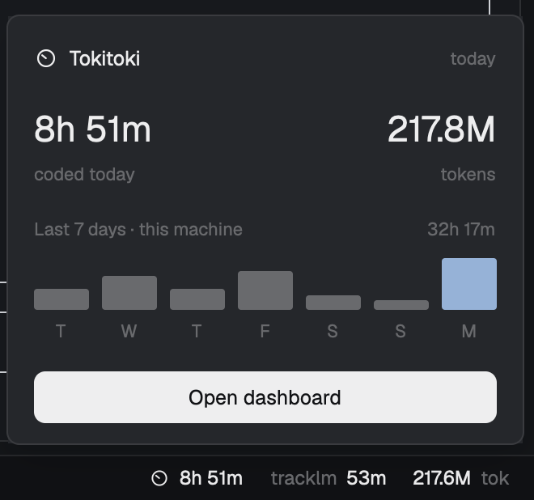

# Tokitoki for Herdr

Today's coding time and AI tokens from [tokitoki.dev](https://tokitoki.dev)
at the right end of [Herdr](https://herdr.dev)'s status bar. Click it for
today's figures, the last seven days and a link to your dashboard. English,
Japanese or Chinese, following the system language.



## Install

Ask your agent in Herdr:

```text
Add the Herdr mod github.com/tokitoki-dev/tokitoki-herdr to my status bar
```

Or from a clone:

```sh
make install
herdr-app do mod.open '{"name":"tokitoki"}'
```

The popup opens once and puts the strip in the status bar. Herdr's own
layouts are read-only, so it does that on a copy, `main-tokitoki`, and
switches to it.

To remove it, delete `~/.config/herdr-app/mods/tokitoki`, switch back to
`main` and delete `~/.config/herdr-app/layouts/main-tokitoki.json`.

## What it needs

The [Tokitoki CLI](https://github.com/tokitoki-dev/tokitoki-cli) at
`~/.tokitoki/bin/tokitoki`. If it is missing, the mod installs it once from
tokitoki.dev: the CLI only, no service, no `PATH` change. Set
`AUTO_INSTALL = false` in `mods/tokitoki/env.js` to turn that off.

Without an API key the figures are this machine's. Paste a key into the
popup for your account's, across every machine.

## What it records

Time in Herdr's local terminals, as heartbeats (`--editor herdr`) for the
focused terminal's folder. One goes out when focus, the folder, the running
program or an agent's turn changes, at most one per folder every two minutes.
It never reads keystrokes, the screen or commands.

## Develop

```sh
make dev      # against a local CLI build and http://localhost:9093
make check    # load the mod once and report errors
```
