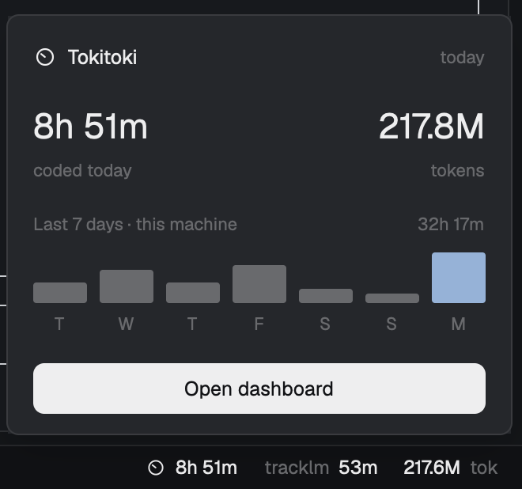

# Tokitoki

A WakaTime-style time tracker for coding and AI agents in Herdr's status bar:
today's coding time, the focused terminal's project and AI token usage
(Claude Code, Codex and more) from [tokitoki.dev](https://tokitoki.dev). Time
tracking is automatic, including time in Herdr's terminals. Click it for a small
popup: today's two figures, the last seven days as bars, and a button to the
dashboard (or, without an account yet, a field for the API key).

## What you see

- **The strip** (in a 28px row with Herdr's status line, 320px at its right end): the status bar's own
  surface (`chrome`, 1px `border` on top), figures at the right end at 11.8px:
  the logo (13px), today's time (`4h 26m`), the focused terminal's project and
  its time (name `dim`, cut at 120px), then tokens (`1.8M` bright, `tok` dim).
  No separators: 16px between items, 5px inside one. The figures are one
  rounded hover target (`hover` background); the rest of the block is empty.
  Without an account it shows time and tokens only; before the CLI exists it
  says "Installing Tokitoki…" or "Set up Tokitoki".
- **The popup** (320px wide, 16px padding, `popover`): a header row with the
  logo, "Tokitoki" and a dim tag on the right ("today", "local only",
  "offline"); two large figures (22px semibold), time on the left and tokens
  set against the right edge, each over a dim label; "Last 7 days · this
  machine" with the week's total on the right and seven bars (32px max, today
  in `accent`, the rest `dim`, weekday initials under them); then either a
  primary button "Open dashboard" (`solid` /
  `solid_foreground`), or a `raised` card: "Connect account" with a small
  accent "Get a key" link on the same row, one line on what a key adds, and a
  26px masked key field with a small "Save" button beside it.
- Text in English, Japanese or Chinese, following the system language.

## How it behaves

- The strip asks the Tokitoki CLI for numbers once a minute, when the focused
  terminal moves to another folder, and right after a key is saved.
- Clicking the figures opens the popup just above the strip, its right edge
  on the strip's; it shows the last known numbers at once, then asks again.
- "Open dashboard" opens the site already signed in (a one-time link from the
  CLI). "Get a key" opens the site's settings. Both close the popup.
- Pasting a key and pressing Enter or Save stores it with the CLI; on success
  a toast says so, the popup closes and the strip switches to the account's
  figures (every machine). A refused key turns the explanation line red.
- Heartbeats: whenever, in the focused local terminal with Herdr in front,
  focus moves, the folder changes, the foreground program changes or an agent
  gets a turn, one heartbeat goes out for that folder: `ai coding` when an
  agent runs there, `coding` otherwise; at most one per folder and category
  every two minutes.
- The first time the popup opens, it puts the strip next to the status line
  (on a copy of the layout when it is one of Herdr's) and says so in a toast.
- No CLI on the machine: the strip installs it once (from tokitoki.dev, CLI
  only), retrying a failed install after an hour.

## Built from

- One mod, `mods/tokitoki`: `main.js` (the view: the strip, or the popup when
  `props().overlay` is set), `data.js` (CLI calls), `track.js` (heartbeats),
  `i18n.js` (words and language detection), `place.js` (putting the strip in the layout), `env.js` (site, CLI folder,
  auto-install), `logo.svg`. Popup opened with `openOverlay({ mod, kind:
  "popup", width, height, at })`.
- `herdr` functions: `layout`, `layouts`, `run` (`layout.set`, `layout.clone`), `theme`, `settings` (zoom), `props`, `openOverlay`,
  `closeOverlay`, `exec`, `home`, `window` (platform, active), `focused`,
  `spaces` (machine), `terminals` (foreground pid, turn, status), `shared` /
  `setShared`, `notify`.
- Programs: the Tokitoki CLI at `~/.tokitoki/bin/tokitoki` (`version`,
  `get key`, `set key`, `stats`, `today`, `project`, `heartbeat`,
  `get dashboard-url`); `open` / `xdg-open` / `cmd /c start` for links;
  `defaults` (macOS), `sh` (Linux), `powershell` (Windows) for the language
  and the one-time install.

## Watch out

- Herdr gives mods no events; a render is the signal. Heartbeats come from
  comparing the focused terminal's footprint between renders, so only the
  strip tracks (never the popup), and one long session inside one program is
  covered only between changes. Keystrokes and the screen are never read.
- Each popup state has a fixed height (`HEIGHT` in `main.js`) so it opens
  above the strip, not over it; change the content, change the height.
- `get key` prints the key: only its exit code is used (3 means no key).
  The dashboard link carries a login token: opened, never stored or logged.
- The mod has no `Intl` or environment: the language comes from `exec`.
  An `InputState` placeholder cannot change after creation.
- Terminals on other machines are not tracked, and get no project name.
- Herdr does not dock a new mod into its own read-only layouts (`main`
  included), so copying the folder shows nothing for most people, and
  nothing is tracked until the strip is in the shown layout. `mod.json` says
  `place: "none"`; the popup places the strip instead (`place.js`): installing
  ends with `herdr-app do mod.open '{"name":"tokitoki"}'`, and the popup
  `layout.set`s the shown layout with the strip after the `workspace-status`
  block (wrapped in a 28px row), and when that is one of Herdr's layouts,
  `layout.clone`s it to `<name>-tokitoki` first. Once only (shared
  `tokitoki.placed`). The popup survives the layout switch the clone makes.

## Done when

- `herdr-app check mods/tokitoki` passes.
- On a fresh Herdr (layout `main`), copying the folder and running
  `mod.open` once leaves the window on `main-tokitoki` with the strip at the
  right end of the status line.
- With the CLI and a key, the strip shows today's time, the project and
  tokens, and the popup's "Open dashboard" opens the site signed in.
- Without a key, the popup shows the key card; saving a valid key closes it
  and the strip shows the account's figures.
- Without the CLI, the strip says it is installing, then shows figures.
- Working in a local terminal for a few minutes adds `herdr` heartbeats
  (`--editor herdr`) to the CLI's queue; a remote terminal adds none.
- On a Chinese or Japanese system the popup is in that language.
